# Agent Lab — Architecture Diagrams

Session-ready architecture for Agent Lab: overview plus five focused areas (Python → chatbot → Ollama, RAG, chunking/Qdrant, Tavily, voice).

---

## Connecting your chatbot (start here)

Use this section when you run the **browser UI** and want to see how a message travels through the stack.

### 1. What must be running

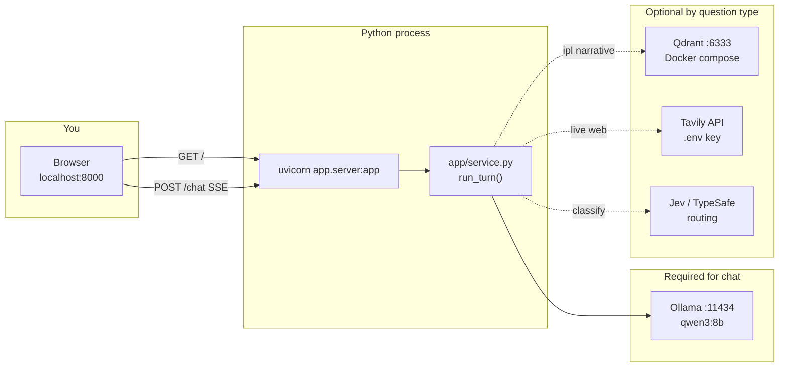

| Step | Command / check |
|------|------------------|
| Ollama | Desktop app or `ollama serve`; models `qwen3:8b` (+ `nomic-embed-text` for RAG) |
| Qdrant (RAG) | `docker compose up -d` then `python -m scripts.ingest` once |
| Web chatbot | `uvicorn app.server:app --reload` → open **http://127.0.0.1:8000/** |
| Terminal only | `python main.py` (skips FastAPI; calls `run_turn()` directly) |

**Important:** `main.py` and the Web UI are two **front doors** into the same `run_turn()` function. Only the Web UI needs Uvicorn.

### 2. Web UI — one message, full path

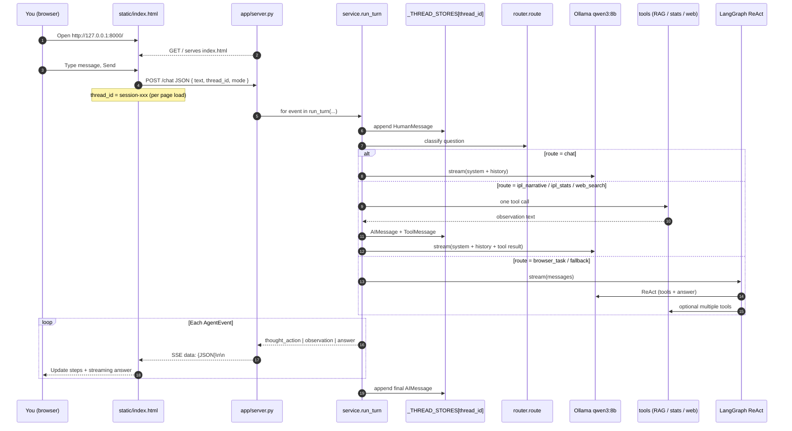

### 3. How the UI talks to Python (contract)

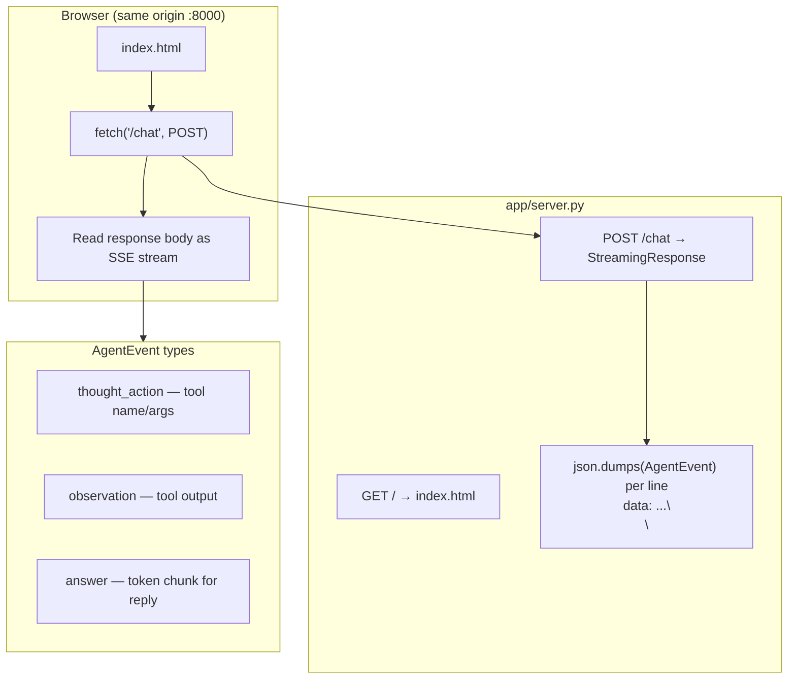

| `AgentEvent.type` | What you see in the UI |
|-------------------|-------------------------|
| `thought_action` | “Tool” step (e.g. `search_docs(...)`) |
| `observation` | Tool result snippet |
| `answer` | Assistant text streamed into the bubble |

Code anchors: `app/server.py` (`ChatRequest`, `/chat`), `static/index.html` (parse `data: ` lines), `app/service.py` (`run_turn` yields events).

### 4. Conversation context (short-term memory)

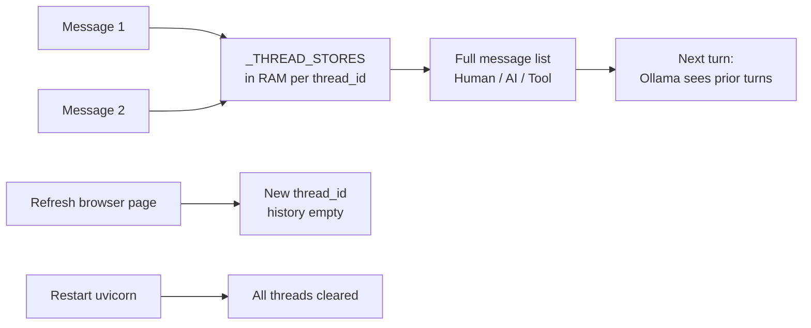

- **Same tab, same session:** follow-up questions can use earlier messages in that `thread_id`.
- **Not persisted:** restarting the server or refreshing the page starts a new thread (no disk DB yet; `app/memory.py` is Phase 5).

### 5. Where each question type goes (after routing)

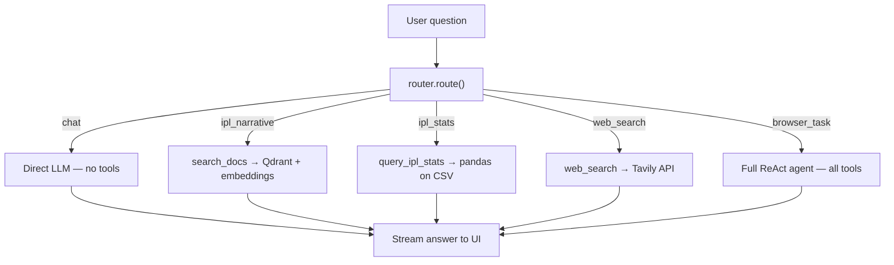

---

## Master overview

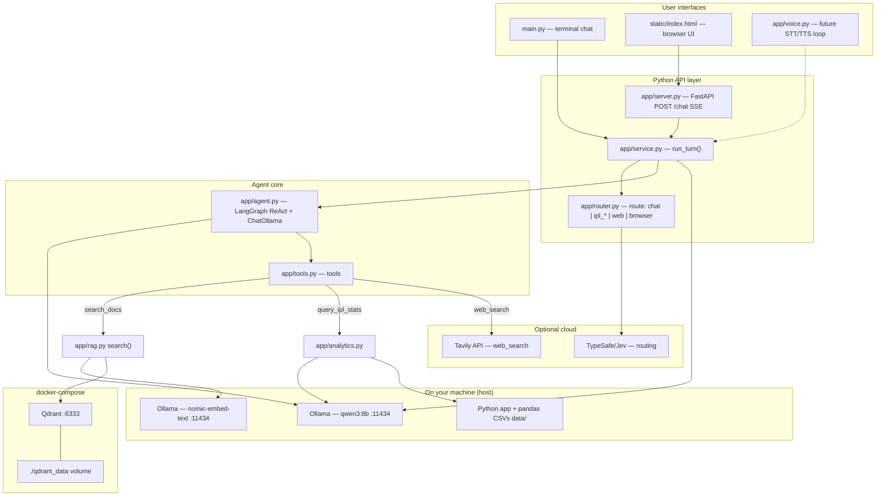

**Talking point:** Almost everything is **local** (Ollama + Python + Qdrant in Docker). **Tavily** and **Jev routing** are the main optional external calls.

---

## 1. Python → chatbot → Ollama

Two entry paths share the same brain: `run_turn()` in `app/service.py`.

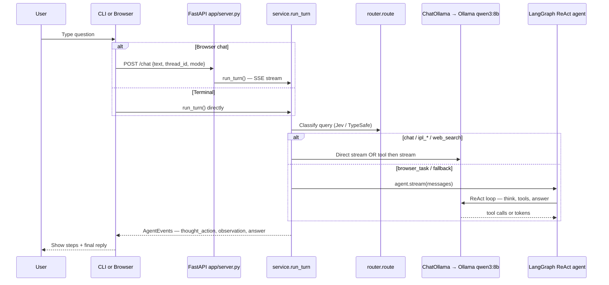

| Layer | Role |
|--------|------|
| `main.py` | CLI; checks Ollama; `--mode text\|voice`, `--thread` |
| `app/server.py` | Serves UI + **Server-Sent Events** from `run_turn()` |
| `app/service.py` | Thread memory, routing, streaming events |
| `app/agent.py` | `get_ollama_llm()` → `http://localhost:11434`, `build_agent()` |

**Demo:** `python main.py` or Uvicorn on `app.server:app`.

---

## 2. How RAG connects (offline ingest vs online query)

RAG is **vectors in Qdrant** + **retrieval at tool time**, not weights inside the LLM.

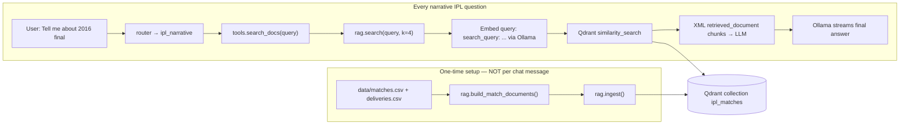

| Step | Code |
|------|------|
| Ingest CLI | `python -m scripts.ingest` → `app.rag.ingest()` |
| Retrieval tool | `search_docs` in `app/tools.py` → `app.rag.search()` |
| Qdrant URL | `QDRANT_URL=http://localhost:6333` (matches `docker-compose`) |
| Embeddings | `NomicEmbeddingsWrapper` — `search_document:` / `search_query:` prefixes |

**Parallel path (not vector RAG):** `ipl_stats` → `query_ipl_stats` → `app/analytics.py` (pandas on CSVs).

---

## 3. Chunking → Qdrant (Docker Compose)

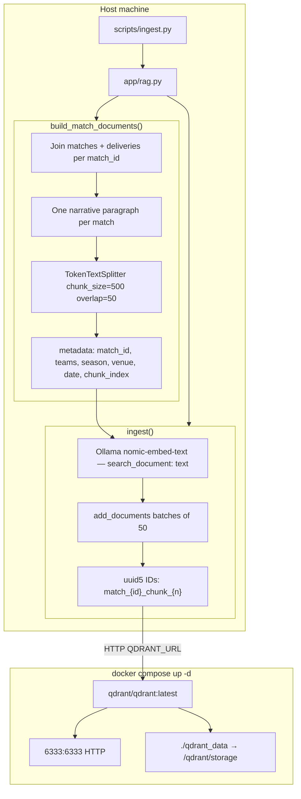

**Session bullets:**

- **Chunking** happens only during **ingest**, in `build_match_documents()` (`TokenTextSplitter`).
- Most match summaries are short → often **1 chunk per match**; splitter is a safety net for long text.
- **Persistence:** vectors live in `./qdrant_data` on the host; restarting the container keeps data.
- **Re-index:** `python -m scripts.ingest --reset` drops collection and rebuilds.

---

## 4. Tavily search

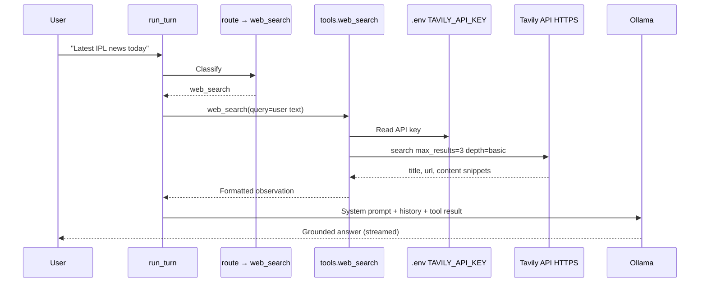

| Tool | Data source | Example |
|------|-------------|---------|
| `search_docs` | Qdrant + IPL narratives | "What happened in the 2016 final?" |
| `query_ipl_stats` | Local CSV + pandas | "Most runs in IPL history?" |
| `web_search` | **Tavily** (internet) | "Today's cricket headlines" |

If `TAVILY_API_KEY` is missing, the tool returns a clear error (search disabled).

**ReAct fallback:** `build_agent()` also registers `web_search` for full agent tool use.

---

## 5. Voice-ready Agent Lab

Short plain answers + browser STT/TTS; same backend as text.

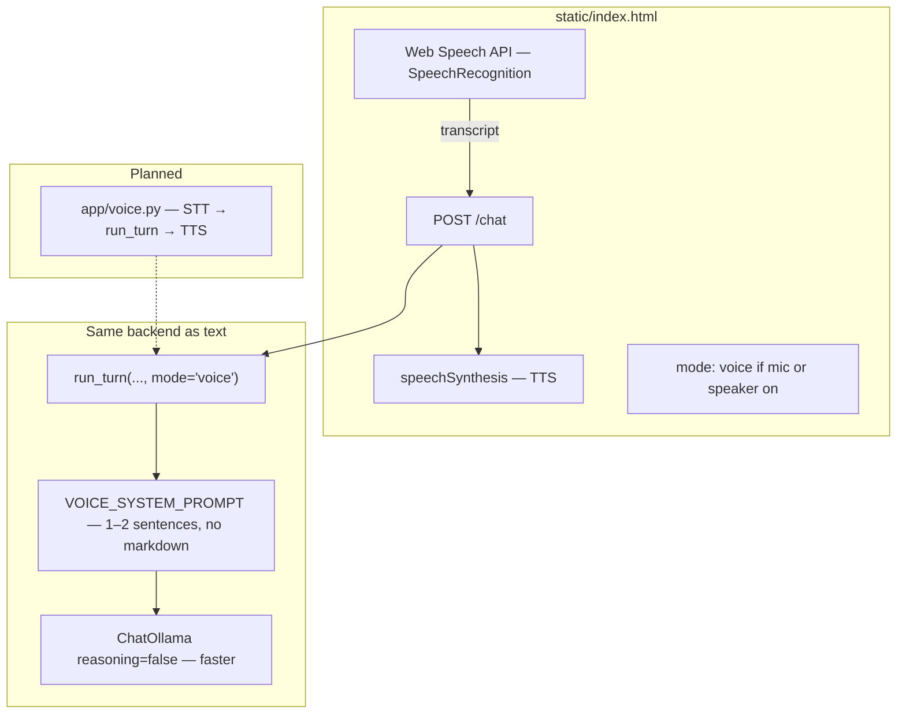

| Piece | Status |
|--------|--------|
| `mode=voice` + `VOICE_SYSTEM_PROMPT` | `app/agent.py` / `app/service.py` |
| CLI | `python main.py --mode voice` |
| Web UI | Mic + speaker; `mode: 'voice'` |
| `app/voice.py` | Stub — future STT/TTS loop |

---

## Suggested demo order

1. `docker compose up -d` → Qdrant on `:6333`
2. `python -m scripts.ingest` → chunking + embeddings (one-time)
3. `python main.py` or web UI → narrative → `search_docs` → Qdrant
4. Stats question → `query_ipl_stats`
5. Live news → `web_search` → Tavily
6. Voice / `--mode voice` → short answers

---

## ASCII deployment (optional slide)

```
┌─────────────────────────────────────────────────────────────┐
│  Browser (index.html)  or  main.py CLI                       │
└───────────────────────────┬─────────────────────────────────┘
                            │ run_turn(thread_id, mode)
┌───────────────────────────▼─────────────────────────────────┐
│  service.py → router → tools OR LangGraph ReAct agent        │
└─────┬──────────────┬──────────────┬─────────────────────────┘
      │              │              │
      ▼              ▼              ▼
 Ollama:11434    Qdrant:6333     Tavily API
 (qwen3 +        (docker-compose  (web_search)
  nomic-embed)    + qdrant_data)
      ▲
      │ ingest: CSV → chunk → embed → index
 scripts/ingest.py
```


flowchart LR
  User[User CLI / future Voice / API]
  Service[app/service.py run_turn]
  Agent[LangGraph ReAct agent]
  LLM[Ollama qwen3:8b]
  Tools[Tools layer]
  RAG[search_docs → Qdrant + embeddings]
  Stats[query_ipl_stats → pandas sandbox]
  Web[web_search → Tavily]
  User --> Service --> Agent --> LLM
  Agent --> Tools
  Tools --> RAG
  Tools --> Stats
  Tools --> Web
  RAG --> Qdrant[(Qdrant Docker)]
  RAG --> Embed[Ollama nomic-embed-text]
